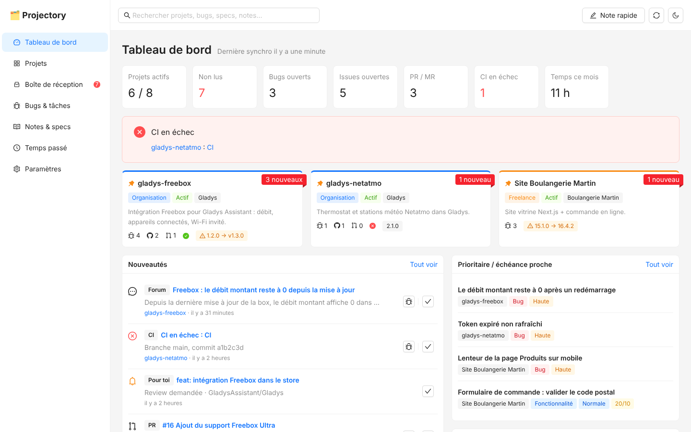
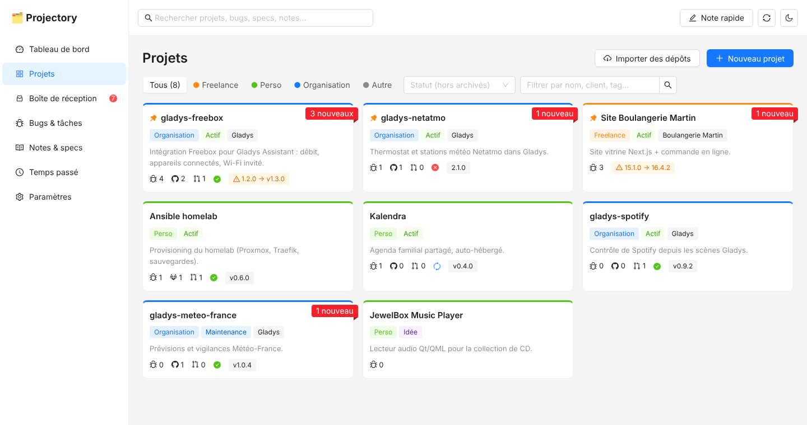
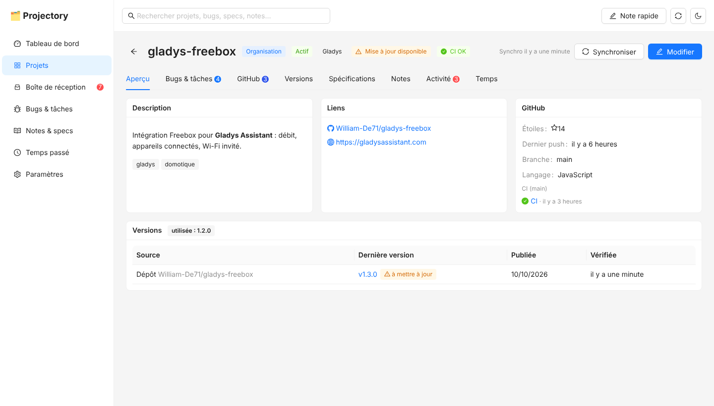
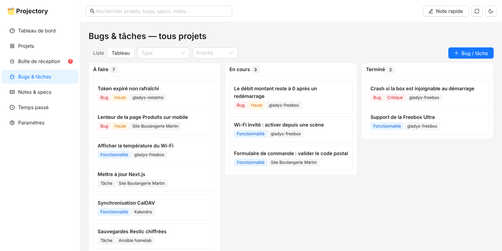
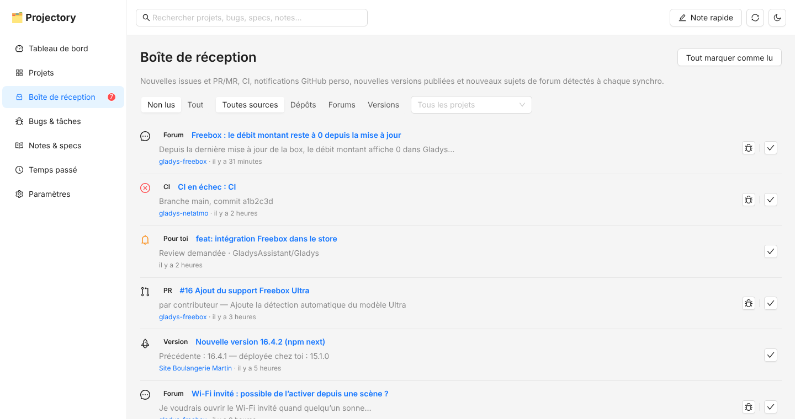
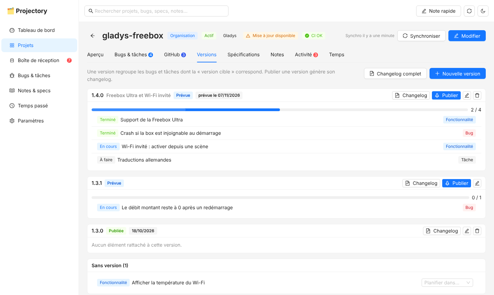
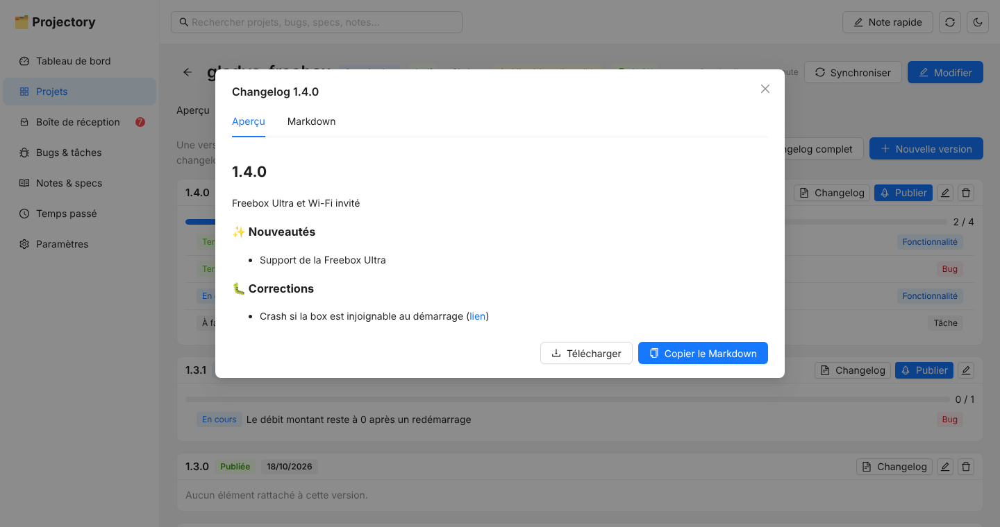

<div align="center">

# 🗂️ Projectory

**Suivi de tous tes projets de dev au même endroit : GitHub / GitLab / Gitea, CI, versions, bugs du forum, roadmap, specs, notes et temps passé.**

[](https://github.com/William-De71/projectory/actions/workflows/ci.yml)
[](https://github.com/William-De71/projectory/releases)

Auto-hébergé (Docker), mono-utilisateur, données dans un seul fichier SQLite.

**Français** · [English](README.en.md)

</div>

<picture>
  <source media="(prefers-color-scheme: dark)" srcset="docs/screenshots/dashboard-dark.png">
  
</picture>

---

## Fonctionnalités

| | |
|---|---|
| **Projets classés par catégories** | Freelance, Perso, Organisation (Gladys…), Autre — catégories modifiables avec couleur. Statut (idée, actif, maintenance, pause, archivé), client, tags, liens, épinglage. |
| **GitHub, GitLab, Gitea / Forgejo** | Chaque projet pointe vers un dépôt sur github.com, gitlab.com ou une instance auto-hébergée (GitLab, Gitea, Forgejo). Un token par instance dans **Paramètres → Forges et tokens**. |
| **Import de dépôts en masse** | Liste les dépôts d'un utilisateur, d'une organisation ou d'un groupe (filtre, forks, archivés) et crée les projets d'un coup avec catégorie, statut et suivi des releases. Les dépôts déjà suivis sont ignorés. |
| **Suivi des dépôts** | Issues et PR / MR ouvertes, étoiles, dernière activité. Les **nouvelles** arrivent dans la boîte de réception ; un bouton « Suivre » les ajoute aux bugs & tâches. |
| **Créer une issue depuis un bug** | Un bug remonté par le forum devient une issue sur le dépôt (titre, description, lien du forum, version cible, label). Lien dans les deux sens : quand l'issue est fermée, le bug passe à « Terminé ». |
| **État de la CI** | GitHub Actions (dernier run de chaque workflow), pipelines GitLab, statuts de commit Gitea/Forgejo (Actions, Woodpecker, Drone) sur la branche principale : pastille verte/rouge, alerte au tableau de bord, notification quand la CI casse puis repasse au vert. |
| **Notifications GitHub perso** | Reviews demandées, mentions, assignations, réponses sur tes issues/PR (ex. vers GladysAssistant/Gladys), rattachées au projet suivi correspondant. Nécessite un token classique avec le scope `notifications`. |
| **Versions & changelog** | Onglet **Versions** par projet : jalons (1.2.0, 1.3.0…) avec date prévue, progression, éléments planifiés et non planifiés. **Publier** une version génère son changelog Markdown (nouveautés / corrections / autres) à copier, télécharger ou garder en note ; changelog complet du projet en un clic. |
| **Notifications push ntfy** | Nouveautés envoyées sur ton téléphone via [ntfy](https://ntfy.sh) (serveur public ou auto-hébergé, token supporté), choix des événements, regroupement au-delà de 3 nouveautés, projets rendus muets individuellement. |
| **Veille des versions** | Dernière release/tag du dépôt (toute forge), d'un autre dépôt GitHub, d'un paquet npm ou d'une image Docker Hub, comparée à la version que *tu* utilises/déploies → badge « mise à jour disponible » et notification. |
| **Bugs remontés par un forum** | Forums **Discourse** (ex. [forum Gladys](https://community.gladysassistant.com) : catégorie, tag ou recherche) et **flux RSS/Atom** (filtre par mots-clés). Un clic transforme un sujet en bug suivi. |
| **Bugs & tâches manuels** | Bug / fonctionnalité / tâche / question, priorité, statut, échéance, version cible, lien externe. Vue liste ou tableau Kanban (glisser-déposer). |
| **Spécifications** | Documents Markdown par projet avec modèle prérempli (contexte, objectifs, critères d'acceptation…) et statut brouillon / à relire / validée. |
| **Notes** | Notes Markdown par projet ou globales, bouton « Note rapide » partout dans l'app. |
| **Temps passé** | Saisie rapide par projet, total du mois et par projet (pratique pour facturer le freelance). |
| **Boîte de réception** | Tout ce qui est nouveau depuis la dernière synchro, lu/non lu, filtres par source et projet. |
| **Tableau de bord** | Chiffres clés, nouveautés, prioritaire / échéances proches, mises à jour dispo, PR récentes, erreurs de synchro. |
| **Recherche globale** | Projets, bugs, specs, notes, issues et PR des dépôts. |
| **Export** | JSON complet en un clic, ou copie du fichier `data/projectory.db`. |

Thème clair/sombre, interface en français, utilisable sur mobile.

### Aperçu

| | |
|---|---|
|  |  |
| **Projets** — catégories, compteurs, CI, mises à jour disponibles | **Fiche projet** — dépôt, CI, versions utilisée / publiée |
|  |  |
| **Bugs & tâches** — liste ou Kanban, tous projets confondus | **Boîte de réception** — forum, dépôts, CI, versions, notifications perso |
|  |  |
| **Versions** — jalons, progression, éléments sans version | **Changelog** — généré à la publication, à copier ou télécharger |

<sub>Captures réalisées avec des données de démonstration.</sub>

> 💡 À la **première** synchro d'une source, l'existant est enregistré comme déjà lu : seules les nouveautés suivantes apparaissent en non lu.

---

## Démarrage avec Docker (recommandé)

Les images sont publiées sur GitHub Container Registry pour `amd64` et `arm64` (Raspberry Pi, NAS…) :

| Tag | Contenu |
|---|---|
| `latest` | dernière release |
| `1.2.3`, `1.2`, `1` | une release précise / la dernière d'une branche de versions |
| `dev`, `dev-<sha>` | dernier commit de `main` (images de développement) |

```bash
mkdir projectory && cd projectory
curl -O https://raw.githubusercontent.com/William-De71/projectory/main/docker-compose.yml
curl -o .env https://raw.githubusercontent.com/William-De71/projectory/main/.env.example   # puis édite-le
docker compose up -d
```

Ouvre http://localhost:3001. Les données sont dans `./data/projectory.db`.

- Mise à jour : `docker compose pull && docker compose up -d`
- Tester la version de dev : `PROJECTORY_TAG=dev` dans `.env`
- Construire depuis les sources : `docker compose -f docker-compose.yml -f docker-compose.build.yml up -d --build`

> Le premier push d'une image sur GHCR crée un paquet **privé**. Rends-le public (GitHub → ton profil → Packages → projectory → Package settings → Change visibility) ou fais `docker login ghcr.io` avant le `pull`.

### Configuration (`.env`)

| Variable | Défaut | Rôle |
|---|---|---|
| `GITHUB_TOKEN` | — | Token GitHub (les comptes saisis dans **Paramètres → Forges et tokens** sont prioritaires). Sans token : 60 requêtes/heure et dépôts publics seulement. *Fine-grained* : Metadata, Contents, Pull requests, Actions en lecture + Issues en écriture. Pour les notifications perso : token **classique** avec les scopes `repo` et `notifications`. |
| `GITLAB_TOKEN` | — | Token GitLab par défaut (scope `api`, ou `read_api` sans création d'issues). |
| `GITEA_URL`, `GITEA_TOKEN` | — | Instance Gitea / Forgejo par défaut et son token (droits repository + issue). |
| `PROJECTORY_TAG` | `latest` | Tag de l'image Docker utilisée par `docker-compose.yml`. |
| `SYNC_INTERVAL_MINUTES` | `30` | Synchro automatique (0 = uniquement via le bouton 🔄). |
| `APP_PASSWORD` | — | Active une authentification HTTP basique (identifiant libre). À mettre si l'app est exposée hors de ton réseau. |
| `PROJECTORY_PORT` | `3001` | Port exposé sur l'hôte. |
| `NTFY_SERVER`, `NTFY_TOPIC`, `NTFY_TOKEN` | `https://ntfy.sh`, —, — | Valeurs par défaut des notifications ; se règlent plutôt dans **Paramètres → Notifications push**. |
| `APP_URL` | — | Adresse de Projectory (ex. `http://192.168.1.10:3001`), utilisée par les liens des notifications. |
| `LOG_LEVEL` | `info` | Niveau de logs. |

### Sauvegarde

Copie `data/projectory.db` (idéalement app arrêtée, ou via `sqlite3 data/projectory.db ".backup backup.db"`), ou utilise **Paramètres → Exporter en JSON**.

---

## Démarrage rapide avec tes dépôts

1. **Projets → Importer des dépôts** : choisis la forge, laisse le champ vide pour lister les dépôts du propriétaire du token (ou saisis `William-De71`), filtre sur `gladys-`, coche, choisis la catégorie, puis **Importer**.
2. La première synchro démarre en arrière-plan. Elle enregistre l'existant comme déjà lu, donc pas d'avalanche de notifications.
3. **Paramètres → Notifications push** : installe l'app ntfy sur ton téléphone, abonne-toi à un topic difficile à deviner, renseigne-le ici, puis **Envoyer un test**.

## Exemple : suivre Gladys

Dans **Projets → Nouveau projet** :

- **Catégorie** : Organisation — **Client** : Gladys
- **Dépôt** : GitHub, `GladysAssistant/Gladys`
- **Version utilisée** : celle installée chez toi, ex. `4.45.0`
- **Versions** : « Releases du dépôt » + « Image Docker Hub » → `gladysassistant/gladys`
- **Forum** : `Forum Discourse`, URL `https://community.gladysassistant.com`, puis au choix :
  - chemin vide → derniers sujets
  - chemin `c/<slug>/<id>` → une catégorie (l'URL de la catégorie sur le forum, sans le domaine)
  - chemin `tag/zigbee` → un tag
  - recherche `zigbee2mqtt order:latest` → résultats d'une recherche

Pour un forum non-Discourse, utilise son flux RSS/Atom (Discourse expose aussi `…/latest.rss`) avec des mots-clés en filtre : `bug, erreur, crash`.

---

## Développement

Prérequis : Node.js ≥ 22.13 (SQLite intégré à Node, aucune dépendance native).

```bash
# API (port 3001), données dans ./data
cd server && npm install && npm run dev

# Front (port 5173, proxy /api vers 3001)
cd web && npm install && npm run dev

# Tests de l'API (forges, forums et ntfy simulés)
cd server && npm test
```

### CI, images de dev et releases (GitHub Actions)

| Workflow | Déclencheur | Ce qu'il fait |
|---|---|---|
| **CI** (`ci.yml`) | push sur `main`, pull request, lancement manuel | Tests de l'API, build du front, puis image Docker. Sur `main` : publie `ghcr.io/william-de71/projectory:dev` et `:dev-<sha>` (amd64 + arm64). En PR : build seul, rien n'est publié. En manuel depuis une branche : publie `:dev-<branche>`. |
| **Release** (`release.yml`) | **Actions → Release → Run workflow**, choix `patch` / `minor` / `major` | Tests, calcul de la version suivante depuis le dernier tag `vX.Y.Z`, mise à jour des `package.json` et de `CHANGELOG.md` (commits classés en nouveautés / corrections / autres), commit + tag sur `main`, release GitHub avec les notes, images `:X.Y.Z`, `:X.Y`, `:X` et `:latest`. |

Pour un changelog propre, préfixe tes commits : `feat: …` (nouveauté), `fix: …` (correction) ; le reste va dans « Autres changements ».
La release pousse sur `main` avec le `GITHUB_TOKEN` du workflow : si tu protèges `main`, autorise GitHub Actions à contourner la règle.

### Architecture

```
projectory/
├── server/                 Fastify 5, ESM, node:sqlite
│   ├── src/
│   │   ├── index.js        démarrage + planificateur de synchro
│   │   ├── app.js          routes, auth optionnelle, service du front buildé
│   │   ├── db.js           schéma SQLite + migrations (PRAGMA user_version)
│   │   ├── routes/         projects, content (items/docs/catégories/temps), overview (inbox/dashboard/recherche/export)
│   │   │                   integrations (import, issues, comptes, notifications), milestones (versions, changelog)
│   │   └── sync/           forges/ (github, gitlab, gitea), sources.js (versions npm/Docker, Discourse, RSS), notify.js (ntfy), index.js (orchestration)
│   └── test/
├── web/                    React 19 + Vite + Ant Design 6
│   └── src/{pages,components,api}
├── data/                   volume : projectory.db
├── .github/                workflows CI / Release, scripts/release.mjs
├── Dockerfile              une seule image : build du front + API qui le sert
├── docker-compose.yml      image GHCR
└── docker-compose.build.yml  surcharge pour construire depuis les sources
```

Inspiré dans l'esprit de [portfolio-manager](https://github.com/AymericLeFeyer/portfolio-manager) (Fastify + React/Ant Design, CRUD en tiroirs, docker-compose), mais écrit de zéro.

---

## Idées pour la suite

- Notifications perso GitLab (todos) et Gitea / Forgejo
- Facturation : taux horaire par projet freelance, export CSV du temps passé
- Publier la release sur la forge directement depuis l'onglet Versions
- Import des notes depuis le bloc-notes (copier-coller → découpage en notes)
